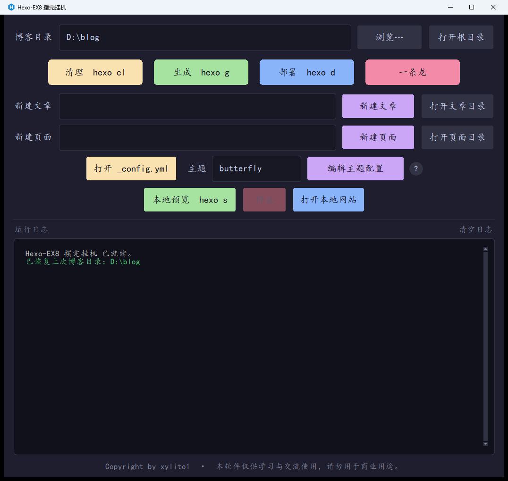

# Hexo-EX8 摆完挂机

> 一个给 Hexo 博客用的 Windows 桌面小工具：把「清理缓存 / 生成静态文件 / 部署」做成一键按钮，顺手把新建文章、新建页面、主题配置编辑、本地预览也一起收进同一个窗口。

不用再开命令行敲 `hexo cl`、敲错了等半天、忘了关预览占着 4000 端口。双击打开，选好博客目录，之后所有操作点按钮就行。



---

## 特性一览

| 能力 | 说明 |
| --- | --- |
| 一键清理 / 生成 / 部署 | 对应 `hexo cl`、`hexo g`、`hexo d`，按钮文字与命令同时标在界面上，不会点错 |
| 一条龙 | 按 清理 → 生成 → 部署 顺序串行执行，中途失败立刻停下，不会带着报错继续部署 |
| 新建文章 / 页面 | 在窗口里填标题直接创建，标题里的空格**原样保留**，不会被 Hexo 改成短横线 |
| 配置入口 | 一键打开站点 `_config.yml` 和主题配置文件，自动按 Butterfly 等主题的惯例找文件 |
| 本地预览 | 启动 `hexo s`、一键停止（连子进程一起结束）、打开浏览器看效果 |
| 目录记忆 | 记住上次用的博客目录，下次启动自动填好 |
| 不弹黑框 | 所有 Hexo 命令在后台静默执行，不会闪出命令行窗口 |
| 日志可读 | 深色日志面板，成功 / 警告 / 错误自动分色，自动滚动到最新一行 |

---

## 运行环境

| 必需项 | 说明 |
| --- | --- |
| 操作系统 | Windows 10 / 11（64 位） |
| Node.js + hexo-cli | 本工具是给已装好 Hexo 的博客用的壳，Hexo 本身需要另外安装 |
| 其他依赖 | 无。exe 已把运行环境打包进去，下载解压即用，不需要额外装任何运行库 |

安装 hexo-cli（如果还没装）：

```bash
npm install -g hexo-cli
```

装完开一个新的命令行窗口验证：

```bash
hexo version
```

能打印版本号就说明环境就绪。

---

## 下载与启动

1. 到本仓库的 **Releases** 页面下载最新版 `Hexo-EX8 摆完挂机.exe`（单文件，11,593,830 字节，约 11.6 MB）。
2. 放到任意文件夹双击运行，无需安装、无需管理员权限。
3. 首次启动时「博客目录」是空的；程序会尝试读取上次记录，没有记录就手动选一次。
4. 选中目录后建议先点一次「生成 hexo g」，能看到进度日志就说明 Hexo 环境通了。

> 程序只读取你指定的博客目录并调用本机的 `hexo` 命令，不写入注册表、不安装服务、不修改系统设置。

---

## 快速上手

1. 点击「浏览…」选择博客根目录——就是包含 `_config.yml` 的那一层，例如 `D:\blog`。
2. 点「生成 hexo g」验证环境。
3. 写文章：在「新建文章」输入框填标题，回车或点按钮。
4. 发布：「一条龙」一次走完 清理 → 生成 → 部署；想分步就依次点「清理 hexo cl」「生成 hexo g」「部署 hexo d」。
5. 想先看看效果：点「本地预览 hexo s」，再点「打开本地网站」，看完记得点「停止」。

---

## 功能详解

### 1. 博客目录

- 手动输入路径，或点「浏览…」用文件夹选择框挑目录；路径末尾误粘贴的双引号会被自动去掉。
- 「打开根目录」在资源管理器里打开当前博客目录。
- 执行任何命令前都会校验目录：
  - 目录为空 → 提示先选择目录；
  - 目录不存在 → 直接报错，不执行命令；
  - 目录里找不到 `_config.yml` → 二次确认，确认后才会继续（防止对着空文件夹跑部署）。
- 校验通过的目录会记入配置，下次启动自动回填，并在日志里提示「已恢复上次博客目录」；如果这个目录后来被删除或改名，会用警告色提示重新选择。

### 2. 命令按钮

| 按钮 | 实际执行 | 说明 |
| --- | --- | --- |
| 清理 `hexo cl` | `hexo cl` | 清掉缓存与已生成的 `public` 静态文件 |
| 生成 `hexo g` | `hexo g` | 生成静态文件 |
| 部署 `hexo d` | `hexo d` | 部署站点，需先在站点配置里写好 deploy 参数 |
| 一条龙 | `hexo cl` → `hexo g` → `hexo d` | 串行执行，每步打印「第 x/3 步」进度；任一步退出码非 0 立即中断，并提示后续步骤不再执行 |

- 命令都在所选博客目录下启动，输出实时写入日志面板，不需要等命令全部跑完才看到内容。
- 任务执行期间所有按钮自动置灰、鼠标变等待状态，结束后恢复，避免手抖连点造成并发执行。
- 每个任务结束都会补一行「完成 / 失败（退出码 X），用时 Y 秒」，方便判断到底成没成。
- 本机找不到 `hexo` 命令时，日志会直接提示先安装 `hexo-cli`，而不是只丢一句「不是内部或外部命令」。

### 3. 新建文章 / 新建页面

| 操作 | 需要填 | 实际生成 |
| --- | --- | --- |
| 新建文章 | 文章标题 | `source/_posts/<标题>.md` |
| 新建页面 | 页面名（如 `about`、`tags`、`music`） | `source/<页面名>/index.md` |

- 输入框里按回车等同于点对应按钮。
- 内部用 `--path` 显式指定文件名，所以标题里的空格不会被转成 `-`，文件名和你输入的一致，完整标题仍写入文章头部信息。
- 标题为空会弹窗提示并聚焦回输入框，不会创建出奇怪的文件。
- 创建成功后输入框自动清空，方便连续写下一篇。
- 「打开文章目录」跳到 `source/_posts`；「打开页面目录」跳到 `source`，该目录不存在时退回博客根目录；目录真的找不到会弹窗提示，不会点了没反应。

### 4. 配置文件入口

- 「打开 _config.yml」：打开博客根目录的站点主配置；文件不存在会提示，不会静默失败。
- 「主题」输入框填 `themes` 下的主题文件夹名字（默认 `butterfly`），点「编辑主题配置」后按顺序找第一个存在的文件并打开：

  1. `<博客根目录>/_config.<主题名>.yml`（Butterfly 等主题推荐的独立配置）
  2. `<博客根目录>/_config_<主题名>.yml`
  3. `<博客根目录>/themes/<主题名>/_config.yml`（主题自带配置）

- 三个都没有时，会问你要不要在博客根目录新建 `_config.<主题名>.yml`，确认后写入一行注释并打开，省得自己建文件。
- 如果打开的是第 3 种（主题自带配置），日志会提醒一句：升级主题会覆盖这个文件，建议复制到根目录再改。
- 主题名会做合法性检查：含 `\ / : * ? " < > |` 或写成 `.`、`..` 时拒绝执行并说明原因。
- 「编辑主题配置」右边的圆圈问号可以悬停看填写说明，移开自动收起，点一下则固定住。
- 打开文件用系统默认关联程序，装的是 VSCode 就开 VSCode，没关联时会退回记事本。

### 5. 本地预览

- 「本地预览 hexo s」启动本地服务，进程会一直驻留，需要手动停；预览已经在跑时再点会直接提示「本地预览已经在运行」，不会重复起一个进程。
- 「停止」通过结束整个进程树来收尾，把 `cmd`、`node` 子进程一起带走，不会留下占着 4000 端口的孤儿进程；没在预览时按钮是灰的。
- 「打开本地网站」会先探测 `http://localhost:4000`（2 秒超时），分三种情况：
  - 连不上 → 问你要不要现在启动预览；
  - 能连上但返回 404 → 提示服务在跑但首页还没生成好，先点「生成 hexo g」或等几秒；
  - 正常 → 直接调默认浏览器打开。
- 直接点窗口右上角关闭时，如果预览还在跑，程序会先把预览进程结束再退出。

### 6. 运行日志

- 深色圆角面板，「清空日志」一键清屏。
- 写入前统一剥离命令输出里的 ANSI 颜色控制码，避免 Tk 文本控件把颜色码显示成一堆方块或乱码。
- 分色规则：命令回显白色；含 `ERROR` / `FATAL` / 错误 / 异常 / 失败 的红色；含 `WARN` / 警告 的黄色；含 `SUCCESS` / 完成 的绿色；普通提示灰色。
- 日志面板带暗色滚动条，支持鼠标选中复制（选中反白），新内容自动滚动到最新一行。

---

## 配置与数据存放

工具只记两样东西：博客目录和主题名。

| 内容 | 位置 |
| --- | --- |
| 配置文件 | `%APPDATA%\Hexo-EX8\hexo-gui-config.json` |
| 图标（可选，想换图标时自行放置） | 与 exe 同目录的 `logo.png` |

配置示例：

```json
{
  "site_dir": "D:\\blog",
  "theme": "butterfly"
}
```

几点说明：

- 配置固定放在 `%APPDATA%\Hexo-EX8`，exe 放哪都不影响，也不会因为单文件程序临时解包目录被清理而丢失。
- 保存是合并写入：只更新这次改动的项，不会把另一项覆盖掉；写盘时先写临时文件再替换，避免中途断电写坏配置。
- 删掉这个 json 等于恢复初始状态，重新选一次目录即可。
- 除这个配置文件外，程序不往别处写数据；`public`、`db.json` 这些都由 `hexo` 命令自己在博客目录里生成。

---

## 常见问题 FAQ

**Q1：日志提示找不到 `hexo` 命令？**

先在命令行执行 `npm install -g hexo-cli`。装完**新开一个窗口**执行 `hexo version` 确认可用，再重启本工具。仍然不行的话，多半是 Node.js 的全局 bin 目录没进系统 PATH。

**Q2：点了按钮什么都没发生？**

看日志区有没有输出和退出码。最常见原因是选的目录不是 Hexo 博客根目录（缺 `_config.yml`），或者这个站点还没执行过 `npm install`。

**Q3：会不会弹出 cmd 黑框？**

不会。子进程用隐藏窗口方式启动，输出通过管道回传，只在日志面板里显示。

**Q4：换个文件夹放 exe，之前的目录记忆还在吗？**

在。配置存在 `%APPDATA%\Hexo-EX8\hexo-gui-config.json`，和 exe 位置无关。

**Q5：停止按钮点了，4000 端口还是被占用？**

本工具只会结束自己启动的预览进程。如果是你在别的命令行窗口手动跑的 `hexo s`，需要到那边结束。

**Q6：打开本地网站提示「首页还没就绪（404）」？**

服务已经起来了，但静态文件还没生成。先点「生成 hexo g」，或者等几秒再打开。

**Q7：新建文章后文件名里的空格还在吗？**

在。本工具用 `--path` 指定文件名，按输入原样保留空格；如果你看到的文件名变了，说明那篇文章不是通过本工具创建的（直接跑 `hexo new` 时 Hexo 会按配置做 slug 处理）。

**Q8：改了主题配置，升级主题后没了？**

你改的应该是 `themes/<主题名>/_config.yml`（主题自带文件），主题升级会覆盖它。把内容复制到根目录的 `_config.<主题名>.yml` 再改就不会丢，工具打开这类文件时也会提醒。

**Q9：能把窗口和文件图标换成自己的吗？**

可以。把 `logo.png` 放在 exe 同目录就会优先用你的图；没有该文件时用内置矢量绘制的图标（尖朝上六边形底 + 居中白色 `H`，主色 `#0E83CD`），并按 16 / 24 / 32 / 48 / 64 多个尺寸交给系统择优显示。

**Q10：有 macOS / Linux 版本吗？**

没有。当前只发布 Windows 64 位 exe。

**Q11：界面上没有我想用的命令？**

本工具只封装了高频的清理、生成、部署、预览、新建这几类操作。其余 Hexo 命令（插件提供的自定义命令、`hexo config` 等）仍然在命令行里执行。

**Q12：软件会联网吗？会上传我的数据吗？**

不会。所有操作都在本机完成，不发起任何外部网络请求，唯一访问的地址是本机的 `http://localhost:4000`（本地预览探测）。

**Q13：杀毒软件报未知程序怎么办？**

未做代码签名的个人工具容易被启发式报警。可以核对文件大小与版本信息（属性里 FileVersion 为 1.0.0.0、CompanyName 为 xylito1）后添加信任；如果不放心，建议先不要运行。

---

## 使用声明

- 作者：**xylito1**
- 版本：**1.0.0**
- 类型：个人开发的 Hexo 辅助工具，与 Hexo 官方及任何主题作者均无隶属关系

使用前请确保已备份站点内容。部署、编辑配置这类操作会直接改动或发布你的博客文件，请自行确认操作后果。

**Copyright by xylito1 · 本软件仅供学习与交流使用，请勿用于商业用途。**
